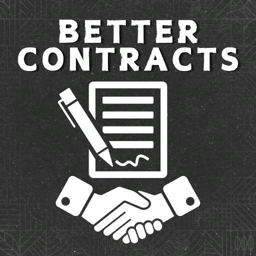

# ModHub upload: Better Contracts

What to enter in the GIANTS ModHub upload form for this mod. Each text box below has a copy button on GitHub.



**Mod Icon (512x512):** [`icon_512.png`](icon_512.png)

| Field | Value |
|-------|-------|
| Title English | Better Contracts |
| Title German | Better Contracts |
| Title French | Better Contracts |
| Version | `1` `3` `2` `1` |
| Author | DTM Mods, Fennell (based on Better Contracts by Mmtrx) |
| Manufacturer | Lizard |
| Category 1 | Gameplay |
| Category 2 | Not Set |
| Category 3 | Not Set |

## Title English
```text
Better Contracts
```

## Title German
```text
Better Contracts
```

## Title French
```text
Better Contracts
```

## Description English
```text
Better Contracts is Mmtrx's mod for the game's contracts, in the DTM Mods edition. It shows more about each job, lets you sort, clear and renew the contracts list, lets you choose the vehicles you lease, and adds a settings tab for rewards, lease costs and which contract types appear.

- Sort contracts by type, revenue, farmer, net profit or profit per minute
- Clear the list or generate new contracts right on the contracts page
- More detail per contract: estimated time, profit per minute, what to deliver and the crop
- Choose the vehicles you lease; active contracts show two progress bars and their time left
- Settings for reward, lease cost, number of active contracts and who may clear the list in multiplayer
- Optional harder game with cancel penalty and deadlines, and a field purchase discount from NPC farmers
- Forage harvest contracts for clover, alfalfa and grass, and a Precision Farming yield setting

How to use: D switches the details on and off, M shows the active contracts display. Settings: game settings menu, Better Contracts tab.

Changelog 1.3.2.0:
- Fixed crashes on the settings tab and with vehicle groups
- Your own mission vehicle list (userDefined.xml) is used even when single vehicles are missing
- No more "could not find appropriate vehicle" warning for some harvest contracts
- A warning when FS25_Contracts_Plus is also loaded (use only one of the two)
```

## Description German
```text
Better Contracts ist Mmtrx' Mod für die Aufträge im Spiel, hier in der Ausgabe von DTM Mods. Er zeigt mehr zu jedem Auftrag, lässt dich die Auftragsliste sortieren, leeren und neu erzeugen, die Leihfahrzeuge selbst wählen und bringt einen Einstellungsreiter für Lohn, Leihkosten und die angebotenen Auftragsarten.

- Aufträge sortieren nach Art, Erlös, Landwirt, Reingewinn oder Gewinn pro Minute
- Liste leeren oder neue Aufträge erzeugen, direkt auf der Auftragsseite
- Mehr Details pro Auftrag: geschätzte Zeit, Gewinn pro Minute, Liefermenge und Fruchtart
- Leihfahrzeuge selbst wählen; aktive Aufträge zeigen zwei Fortschrittsbalken und die Restzeit
- Einstellungen für Lohn, Leihkosten, Anzahl aktiver Aufträge und wer im Multiplayer die Liste leeren darf
- Optional schwereres Spiel mit Strafe bei Abbruch und Fristen, dazu Rabatt beim Landkauf von NPC-Landwirten
- Grünfutter-Ernteaufträge für Klee, Luzerne und Gras sowie eine Precision-Farming-Ertragseinstellung

Bedienung: D schaltet die Details ein und aus, M zeigt die Anzeige der aktiven Aufträge. Einstellungen: Einstellungsmenü des Spiels, Reiter Better Contracts.

Changelog 1.3.2.0:
- Abstürze im Einstellungsreiter und bei Fahrzeuggruppen behoben
- Die eigene Fahrzeugliste (userDefined.xml) wird auch genutzt, wenn einzelne Fahrzeuge fehlen
- Keine Warnung "could not find appropriate vehicle" mehr bei manchen Ernteaufträgen
- Warnung, wenn FS25_Contracts_Plus ebenfalls geladen ist (nur einen der beiden nutzen)
```

## Description French
```text
Better Contracts est le mod de Mmtrx pour les contrats du jeu, dans l'édition DTM Mods. Il affiche plus d'informations sur chaque contrat, permet de trier, vider et renouveler la liste, de choisir les véhicules loués, et ajoute un onglet de réglages pour les récompenses, le coût de location et les types de contrats proposés.

- Trier les contrats par type, revenu, agriculteur, bénéfice net ou bénéfice par minute
- Vider la liste ou générer de nouveaux contrats sur la page des contrats
- Plus de détails : durée estimée, bénéfice par minute, quantité à livrer, culture
- Choisir les véhicules loués ; les contrats actifs ont deux barres de progression et leur temps restant
- Réglages : récompense, coût de location, contrats actifs, qui peut vider la liste en multijoueur
- Jeu plus difficile en option (pénalité d'annulation, délais), remise sur les terres des agriculteurs PNJ
- Contrats de récolte de trèfle, luzerne et herbe, réglage de rendement Precision Farming

Utilisation : D active ou désactive les détails, M affiche les contrats actifs. Réglages : menu des paramètres du jeu, onglet Better Contracts.

Changelog 1.3.2.0 :
- Plantages corrigés dans l'onglet des réglages et avec les groupes de véhicules
- Votre liste de véhicules (userDefined.xml) est utilisée même s'il manque des véhicules
- Plus d'avertissement « could not find appropriate vehicle » pour certains contrats de récolte
- Avertissement si FS25_Contracts_Plus est aussi chargé (n'utilisez que l'un des deux)
```

## Before uploading

- This is a fork of Better Contracts by Mmtrx (GPL-3.0), which is already on ModHub. ModHub rejects copies of existing mods, so this needs Mmtrx's permission; the version 1.3.2.0 is also the same as the original's.
- The mod's own descriptions in modDesc.xml are still Mmtrx's: the German and French ones stop at 1.3.0.7, none mention this edition's additions, and they send players to Mmtrx's GitHub for issues.
- One French in-game text is missing (`bc_genVegetable_tooltip`); German is complete.
